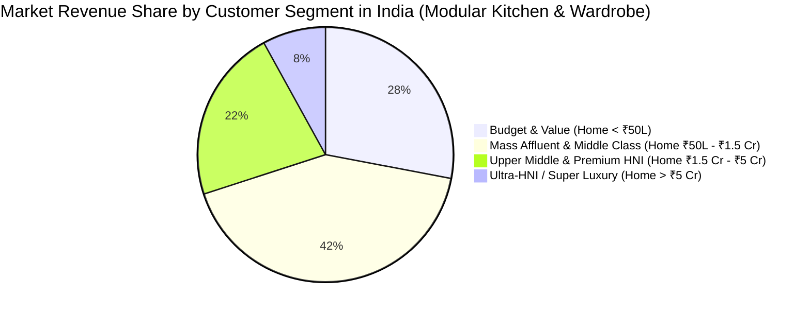

# Master Modular Kitchen & Furniture Pricing Benchmark (India & International)

* **Document Type:** Multi-Brand Comprehensive Pricing & Economic Benchmark
* **Prepared For:** Competitor Intelligence & Market Entry / Strategy Analysis
* **Market:** India Modular Kitchen & Wardrobe Industry (with Imported Luxury Benchmarks)
* **Date:** September 2026

---

## 1. Executive Master Pricing Matrix (25 Brands)

| # | Brand | Origin | Tier / Classification | Target Customer Segment | Base Kitchen Starting Price | Typical Kitchen Project Range | Rate/Sq.Ft (Laminate) | Rate/Sq.Ft (Acrylic) | Rate/Sq.Ft (PU Lacquer) | Rate/Sq.Ft (Glass/Veneer) | Core Carcass Substrate | Hardware Partner | Standard Warranty | Delivery Lead Time |
|---|---|---|---|---|---|---|---|---|---|---|---|---|---|---|
| 1 | **Nobilia** | Germany | Tier 1: Scaled European | Luxury HNI (Home > ₹3 Cr) | ₹3,50,000 | ₹8L – ₹25L+ | ₹2,800 – ₹3,800 | ₹4,000 – ₹5,500 | ₹5,500 – ₹8,000 | ₹7,500 – ₹12,000+ | German E1 Moisture MFC | Hettich Sensys/InnoTech | 10 Yrs | 10–14 Wks (Import) |
| 2 | **Häfele** | Germany | Tier 1: Scaled European | Upper Mid to Luxury HNI | ₹2,50,000 | ₹5L – ₹15L | ₹2,200 – ₹3,200 | ₹3,200 – ₹4,500 | ₹4,500 – ₹7,000 | ₹6,500 – ₹10,000+ | Marine Ply / HDHMR | Häfele MatrixBox / Grass | 10 Yrs / Life | 4–6 Wks (Local assy) |
| 3 | **IFB Kitchens** | India | Tier 1: Scaled Domestic | Upper Middle (Income > ₹25L) | ₹1,55,000 | ₹2.5L – ₹6L | ₹1,400 – ₹2,000 | ₹2,200 – ₹3,200 | ₹3,200 – ₹4,800 | ₹5,000 – ₹7,500 | IS 710 BWP Ply / HDHMR | Hettich / Häfele | 10 Yrs | 45 Days |
| 4 | **Poliform** | Italy | Tier 1: Ultra-Luxury | Ultra-HNI (Home > ₹15 Cr) | ₹18,00,000 | ₹25L – ₹1 Cr+ | *N/A (No laminate)* | ₹8,000 – ₹12,000 | ₹12,000 – ₹20,000 | ₹18,000 – ₹35,000+ | CARB-2 Hydro-Particle / Solid | Custom Blum / Grass | 5–10 Yrs | 14–18 Wks (Import) |
| 5 | **Häcker** | Germany | Tier 1: Scaled European | Luxury HNI (Home > ₹3.5 Cr) | ₹4,50,000 | ₹10L – ₹35L+ | ₹3,000 – ₹4,200 | ₹4,500 – ₹6,000 | ₹6,000 – ₹9,000 | ₹8,500 – ₹15,000+ | PUR Laser-edge Hydro MFC | Grass Nova Pro / Blum | 10–15 Yrs | 12–16 Wks (Import) |
| 6 | **Veneta Cucine**| Italy | Tier 1: Scaled European | Luxury HNI (Home > ₹3 Cr) | ₹5,00,000 | ₹12L – ₹30L+ | ₹3,200 – ₹4,500 | ₹4,800 – ₹6,500 | ₹6,500 – ₹9,500 | ₹9,000 – ₹16,000+ | 100% Recycled CARB-2 Wood | Grass / Blum Italian OEM | 10 Yrs | 12–16 Wks (Import) |
| 7 | **Sleek (Asian Paints)**| India | Tier 2: Challenger | Middle to Upper Middle Class | ₹1,80,000 | ₹2.2L – ₹6.5L | ₹1,200 – ₹1,800 | ₹1,900 – ₹2,800 | ₹2,800 – ₹4,200 | ₹4,200 – ₹6,500 | IS 710 Marine Ply / HDHMR | Grass / Hettich / Sleek | 10 Yrs | 30–45 Days |
| 8 | **HomeLane** | India | Tier 2: Challenger | First-time Middle Homeowners | ₹1,90,000 | ₹2.5L – ₹5.5L | ₹1,300 – ₹1,900 | ₹2,000 – ₹2,900 | ₹3,000 – ₹4,500 | ₹4,500 – ₹6,500 | MDF / HDHMR / BWR Ply | Hettich / Ebco / Häfele | 10 Yrs | 45 Days Guaranteed |
| 9 | **Spacewood** | India | Tier 2: Challenger | Budget to Middle Class | ₹1,49,000 | ₹2.0L – ₹4.5L | ₹1,100 – ₹1,600 | ₹1,700 – ₹2,400 | ₹2,400 – ₹3,600 | ₹3,800 – ₹5,500 | Pre-laminated MFC / Plywood | Hettich / Spacewood OEM | 5–10 Yrs | 25–35 Days |
| 10 | **Panasonic** | Japan | Tier 2: Challenger | Upper Middle to Luxury HNI | ₹1,80,000 | ₹3.0L – ₹10L | ₹1,600 – ₹2,200 | ₹2,400 – ₹3,500 | ₹3,800 – ₹5,500 | ₹5,500 – ₹9,000 | Stainless Steel / MR Ply | Panasonic Japan / Blum | 10 Yrs | 45–60 Days |
| 11 | **Casantro** | India | Tier 2: Challenger | Luxury HNI & Architect Homes | ₹5,00,000 | ₹8L – ₹22L | ₹2,500 – ₹3,500 | ₹3,500 – ₹5,000 | ₹5,000 – ₹7,500 | ₹7,500 – ₹12,000+ | BWP Birch Ply / HDHMR | Blum / Häfele / Grass | 10 Yrs | 45–60 Days |
| 12 | **Itallica** | India | Tier 2: Challenger | Value to Mid-Market | ₹1,20,000 | ₹1.8L – ₹3.5L | ₹950 – ₹1,500 | ₹1,600 – ₹2,400 | ₹2,400 – ₹3,500 | ₹3,500 – ₹5,000 | PVC Board / Comm Ply / HDHMR | Ebco / Local OEM | 5 Yrs | 20–30 Days |
| 13 | **Snaidero** | Italy | Tier 3: Niche Luxury | Ultra-HNI (Pininfarina styling) | ₹15,00,000 | ₹22L – ₹65L+ | *N/A (Bespoke)* | ₹7,000 – ₹10,000 | ₹10,000 – ₹16,000 | ₹15,000 – ₹28,000+ | E1 Eco Hydro-Core Board | Custom Blum / Salice | 10 Yrs | 14–18 Wks (Import) |
| 14 | **Boffi** | Italy | Tier 3: Niche Luxury | Ultra-HNI / Billionaire Estates | ₹25,00,000 | ₹35L – ₹1.2 Cr+ | *N/A (Architectural)*| ₹12,000 – ₹18,000| ₹18,000 – ₹28,000| ₹25,000 – ₹45,000+ | Solid Wood / Corian / Steel | Boffi In-house Engineered | 5–10 Yrs | 16–20 Wks (Import) |
| 15 | **SieMatic** | Germany | Tier 3: Niche Luxury | Luxury HNI (Modern Luxury) | ₹12,00,000 | ₹20L – ₹60L+ | *N/A (No basic finish)*| ₹6,500 – ₹9,500 | ₹9,500 – ₹15,000 | ₹14,000 – ₹25,000+ | High-Density German MFC | SieMatic Multimatic / Grass | 10 Yrs | 14–16 Wks (Import) |
| 16 | **Poggenpohl** | Germany | Tier 3: Niche Luxury | Ultra-HNI (Heritage Luxury) | ₹15,00,000 | ₹25L – ₹75L+ | *N/A (Bespoke)* | ₹7,500 – ₹11,000 | ₹11,000 – ₹18,000 | ₹16,000 – ₹30,000+ | CARB-2 Hydro-Core Board | Concealed German Runners | 10–15 Yrs| 14–18 Wks (Import) |
| 17 | **Nolte Küchen**| Germany | Tier 3: Niche Luxury | Upper Mid to Luxury HNI | ₹3,50,000 | ₹7.5L – ₹24L | ₹2,600 – ₹3,600 | ₹3,800 – ₹5,200 | ₹5,200 – ₹7,800 | ₹7,500 – ₹13,000+ | High Density German MFC | Hettich Premium Line | 5–10 Yrs | 10–14 Wks (Import) |
| 18 | **Scavolini** | Italy | Tier 3: Niche Luxury | Luxury HNI (Italian Lifestyle) | ₹6,00,000 | ₹10L – ₹30L | ₹3,000 – ₹4,200 | ₹4,500 – ₹6,200 | ₹6,200 – ₹9,500 | ₹9,000 – ₹16,000+ | Idroleb Water-repellent Board | Blum Tandembox / Salice | 10 Yrs | 12–16 Wks (Import) |
| 19 | **Würfel Küche**| India | Tier 3: Luxury (Indian) | Upper Mid to Luxury HNI | ₹2,50,000 | ₹5L – ₹18L | ₹2,200 – ₹3,000 | ₹3,200 – ₹4,500 | ₹4,500 – ₹7,000 | ₹6,800 – ₹11,000+ | European E1 Board + Calib Ply | 100% Austrian Blum | 10 Yrs | 45–60 Days |
| 20 | **Pedini** | Italy | Tier 4: Import Only | Ultra-HNI (Curved Architecture)| ₹16,00,000 | ₹24L – ₹65L+ | *N/A (Import)* | ₹7,000 – ₹10,500 | ₹10,500 – ₹17,000 | ₹15,000 – ₹26,000+ | Curved Ecological Panels | Blum / Salice Silentia | 10 Yrs | 16–20 Wks (Direct) |
| 21 | **Lineadecor** | Turkey | Tier 4: Import Only | Upper Mid to Luxury HNI | ₹6,00,000 | ₹9L – ₹22L | ₹2,400 – ₹3,400 | ₹3,500 – ₹5,000 | ₹5,000 – ₹7,500 | ₹7,500 – ₹12,000+ | Turkish E1 Moisture Board | Häfele / Samet | 5–10 Yrs | 12–16 Wks (Direct) |
| 22 | **Livspace** | India | Benchmark Giant | Middle to Upper Middle Class | ₹2,00,000 | ₹2.4L – ₹6.5L | ₹1,400 – ₹2,000 | ₹2,100 – ₹3,000 | ₹3,200 – ₹4,800 | ₹4,800 – ₹7,200 | Anti-bubble Calibrated Ply | Hettich / Blum / Livspace | 10 Yrs | 45 Days |
| 23 | **Godrej Interio**| India| Benchmark Giant | Mass Market to Upper Mid | ₹1,60,000 | ₹2.0L – ₹5.5L | ₹1,300 – ₹1,900 | ₹2,000 – ₹2,800 | ₹2,800 – ₹4,200 | ₹4,200 – ₹6,500 | Galvanized Steel / BWR Ply | Hettich / Godrej OEM | 5–10 Yrs | 30–45 Days |
| 24 | **Arttd'inox** | India | Benchmark (Steel Luxury)| Luxury HNI (Hygienic Steel) | ₹4,50,000 | ₹8L – ₹25L | *N/A (All Steel)* | ₹5,500 – ₹8,000 (SS) | ₹8,000 – ₹12,000 (PU) | ₹12,000 – ₹18,000 (Ceramic)| 100% 304 & 316 Stainless Steel| Austrian Blumotion | 25 Yrs (Steel)| 60–75 Days |
| 25 | **Design Cafe**| India | Benchmark (Space Saving)| Middle Class Families | ₹1,75,000 | ₹2.2L – ₹5.0L | ₹1,250 – ₹1,850 | ₹1,950 – ₹2,800 | ₹2,900 – ₹4,200 | ₹4,200 – ₹6,200 | Commercial / BWR Ply / HDHMR| Häfele / Hettich | 10 Yrs | 45 Days |

---

## 2. Market Segmentation Breakdown: Customer Demographics & Wallet Size



## Segment 1: Ultra-Luxury & Architectural Heritage (Ultra-HNIs)
* **Target Profile:** Industrialists, startup founders, Bollywood/Cricketing celebrities, multi-generational wealth. Own standalone villas, farmhouses, or penthouses valued at ₹10 Cr – ₹100+ Cr.
* **Key Brands:** **Boffi, Poliform, Poggenpohl, SieMatic, Snaidero, Pedini**.
* **Kitchen Budget:** ₹25 Lakhs to ₹1.5 Crore+.
* **Decision Drivers:** Architectural exclusivity, custom Italian/German craftsmanship, hidden handleless pocket door systems, motorized drawers, exotic marble/sintered stone integration, status signaling.

## Segment 2: Premium & Luxury Modernists (High-Net-Worth Individuals - HNIs)
* **Target Profile:** C-Suite executives, doctors, senior tech leaders, elite lawyers. Own 3BHK/4BHK luxury apartments in gated communities (DLF, Prestige, Lodha, Hiranandani) valued at ₹2 Cr – ₹8 Cr.
* **Key Brands:** **Nobilia, Häcker, Veneta Cucine, Nolte Küchen, Scavolini, Würfel Küche, Casantro, Arttd'inox**.
* **Kitchen Budget:** ₹6 Lakhs to ₹25 Lakhs.
* **Decision Drivers:** Authentic European engineering, zero-VOC / E1 health certifications, durable high-gloss lacquer / PU finishes, 100% Austrian Blum or Hettich internal organizational systems.

## Segment 3: Mass Affluent & Tech-First Middle Class
* **Target Profile:** Dual-income salaried professionals (IT, finance, consulting, marketing) buying their first or second apartment valued at ₹60 Lakhs – ₹2 Cr.
* **Key Brands:** **Sleek by Asian Paints, HomeLane, Livspace, IFB, Panasonic (I-Class), Design Cafe, Godrej Interio**.
* **Kitchen Budget:** ₹2 Lakhs to ₹6 Lakhs.
* **Decision Drivers:** 45-day guaranteed delivery timelines, transparent 3D instant pricing calculators, EMI / financing options, trusted corporate brand backing (Tata, Asian Paints, Godrej, Panasonic).

## Segment 4: Value & Budget Segment (Entry-Level Modular)
* **Target Profile:** Tier-2/3 city homeowners, suburban apartments, rental property furnishers, budget-conscious first-time buyers (Home < ₹50 Lakhs).
* **Key Brands:** **Spacewood, Itallica, Local carpentry / IndiaMART modular fabricators**.
* **Kitchen Budget:** ₹1.2 Lakhs to ₹2.5 Lakhs (or ₹900 – ₹1,400/sq.ft).
* **Decision Drivers:** Lowest upfront cost, simple pre-laminated particleboard or PVC shutters, basic wire basket pullouts, quick local installation.

---

## 3. Product & Finish Price Group (PG) Structure

European brands (Nobilia, Häcker, Nolte, Veneta Cucine) categorize shutters into **Price Groups (PG 1 to PG 10)**. This structure governs the multiplier applied to the base carcass cost:

```
[Base Carcass Cost] × [Price Group Multiplier] + [Internal Hardware & Wirework] + [Appliances & Countertop] = Total Project Price
```

| Price Group | Typical Finishes & Materials | Multiplier Index | Typical Rate / Sq. Ft (Cabinetry) | Brands Offering |
|---|---|---|---|---|
| **PG 1 – PG 2** | Melamine resin, Textured Direct Laminate (Matte) | 1.0x (Baseline) | ₹1,200 – ₹2,200 | All domestic & entry European |
| **PG 3 – PG 4** | High-Pressure Laminate (HPL), Anti-fingerprint Supermatte, Soft-lacquer | 1.35x – 1.6x | ₹2,200 – ₹3,500 | Sleek, HomeLane, Nobilia, Nolte |
| **PG 5 – PG 6** | Senosan High-Gloss Acrylic, Multi-coat UV Lacquer, Polymer Glass | 1.8x – 2.4x | ₹3,500 – ₹5,500 | Würfel, Häcker, Veneta Cucine, Nobilia |
| **PG 7 – PG 8** | Seamless High-Gloss & Deep Matte PU Lacquer (Polyester), Metal-finish Lacquer | 2.6x – 3.5x | ₹5,500 – ₹9,000 | Häcker (Systemat), Scavolini, Casantro |
| **PG 9 – PG 10**| Natural Wood Veneer (Smoked Oak, Walnut), Real Back-painted Glass, Sintered Ceramic | 3.8x – 6.0x+ | ₹9,000 – ₹25,000+ | Poliform, Boffi, SieMatic, Poggenpohl |

---

## 4. Typical Room Package Cost Benchmarks

## A. Modular Kitchen (Standard 10 ft × 8 ft L-Shaped Layout, ~80–90 Sq. Ft. Surface Area)
* **Budget Tier (Spacewood, Itallica):** ₹1,50,000 – ₹2,40,000 (Laminate, basic tandem drawers, stainless steel wire baskets).
* **Mid-Market Tier (HomeLane, Sleek, Livspace):** ₹2,50,000 – ₹4,20,000 (Acrylic/Anti-scratch laminate, Hettich soft-close, 1 pantry tall unit).
* **Premium European Tier (Nobilia, Häcker, Nolte, Würfel):** ₹6,50,000 – ₹14,00,000 (German/Italian imported cabinetry, PU lacquer/laser edging, Blum Antaro/Legrabox, LeMans corner unit).
* **Ultra-Luxury Tier (Poliform, Boffi, SieMatic):** ₹22,00,000 – ₹60,00,000+ (Handleless recessed aluminum profiles, motorized servo-drive drawers, ceramic island, integrated Sub-Zero/Miele).

## B. Master Bedroom Wardrobe (Standard 7 ft Height × 6 ft Width, 3-Door Hinged or 2-Door Sliding)
* **Budget Tier:** ₹40,000 – ₹65,000 (Commercial ply/Particleboard, laminate shutters, standard hinges).
* **Mid-Market Tier:** ₹75,000 – ₹1,35,000 (HDHMR/BWR ply, acrylic shutters, soft-close sliding system, internal LED strip, tie/belt pullout).
* **Premium European Tier:** ₹1,80,000 – ₹4,50,000 (Italian/German imported carcass, tinted fluted glass shutters with slim aluminum frames, leatherette drawer liners, integrated sensor lighting).
* **Ultra-Luxury Tier (Poliform Senzafine, Scavolini):** ₹5,50,000 – ₹16,00,000+ (Walk-in wardrobe suite, smoked glass, solid wood internals, dehumidifying airflow system).

---

## 5. Hardware & Accessories Pricing (The Hidden 40% of the Budget)

In modular kitchens, hardware often accounts for **35% to 45% of the total cabinet invoice**. Below are typical component MRPs from **Häfele, Blum, and Hettich** in India:

| Component Type | Entry / Basic Hardware (Local / Ebco) | Mid-Range (Hettich InnoTech / Häfele Metalla) | Premium (Blum Tandembox / Häfele MatrixBox) | Ultra-Luxury (Blum Legrabox / Grass Nova Pro Scala) |
|---|---|---|---|---|
| **Soft-Close Hinge Pair** | ₹150 – ₹300 | ₹450 – ₹750 | ₹850 – ₹1,400 | ₹1,800 – ₹3,200 |
| **Drawer Box System (per drawer)**| ₹1,200 – ₹2,200 | ₹3,200 – ₹5,000 | ₹5,500 – ₹8,500 | ₹9,500 – ₹16,000+ |
| **Tall Pantry Unit (6-layer pullout)**| ₹12,000 – ₹20,000 | ₹32,000 – ₹55,000 | ₹65,000 – ₹1,10,000 | ₹1,30,000 – ₹2,20,000 |
| **Corner Solution (LeMans / Magic Corner)**| ₹8,000 – ₹15,000 | ₹22,000 – ₹38,000 | ₹42,000 – ₹68,000 | ₹75,000 – ₹1,20,000 |
| **Bi-fold Lift-Up System (Overhead)**| ₹2,500 – ₹4,500 | ₹7,500 – ₹12,000 | ₹14,000 – ₹22,000 (Blum HF)| ₹25,000 – ₹45,000 (Servo-Drive Electric) |
| **Cutlery & Organizer Insert** | ₹600 – ₹1,500 | ₹2,200 – ₹4,500 | ₹5,000 – ₹9,500 | ₹12,000 – ₹24,000 (Solid Walnut/Oak) |
