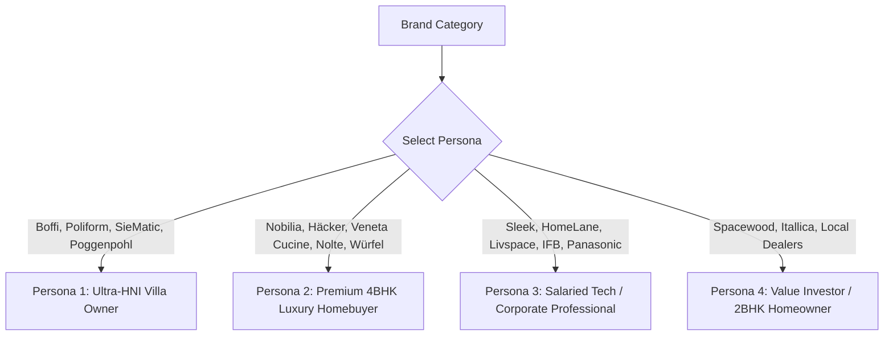

# Primary Research Toolkit: Mystery Shopping Personas, Scripts & Brochure Acquisition Guide

* **Target Objective:** Equip the research team to conduct primary outreach across direct sales channels (WhatsApp, phone, website forms, and experience center visits) to extract **official product brochures, pricebooks, price-per-square-foot metrics, and base quotations**.
* **Prepared for:** BITS Goa Consulting Club (BGCC) & Competitor Intelligence Teams
* **Date:** September 2026

---

## 1. The 4 Target Buyer Personas (Tailored by Market Tier)

Sales executives at premium modular kitchen brands are trained to qualify leads aggressively before handing over brochures and quotations. If you appear to be a student or competitor, they will refuse pricing. Use these personas to match the brand's target demographic:

---

## Persona 1: The Ultra-Luxury Villa / Penthouse Owner
* **Applicable Brands:** **Poliform, Boffi, SieMatic, Poggenpohl, Snaidero, Pedini, Scavolini**.
* **Profile:**
  * **Name:** Vikram Singhania / Ananya Reddy
  * **Occupation:** Tech founder / Managing Director / Family Business Principal
  * **Property:** 5,500 sq. ft. standalone villa or penthouse under possession in a premier development (e.g., DLF Camellias / The Magnolias Gurgaon, Lodha Altamount / Worli Mumbai, Epsilon Villas Bengaluru, Jubilee Hills Hyderabad).
  * **Requirement:** Complete open-plan German/Italian show-kitchen with an island, back-kitchen (wet kitchen for heavy cooking), and master walk-in wardrobe suite.
  * **Budget:** ₹35 Lakhs to ₹75 Lakhs for kitchen + wardrobes.
  * **Tone:** Authoritative, refined, design-literate, inquiring about specific collections and materials (e.g., "handleless finishes", "ceramic worktops", "servo-drive electric drawers").

---

## Persona 2: The Premium 4BHK Luxury Gated Community Homeowner
* **Applicable Brands:** **Nobilia, Häcker, Veneta Cucine, Nolte Küchen, Würfel Küche, Casantro, Arttd'inox**.
* **Profile:**
  * **Name:** Rahul Malhotra / Dr. Neha Kapoor
  * **Occupation:** Senior Corporate VP / Surgeon / Management Consultant
  * **Property:** Newly purchased 4BHK (2,800–3,400 sq. ft.) in an upscale gated complex (e.g., Prestige Kingfisher / Sobha HRC Bengaluru, Oberoi Sky City Mumbai, Godrej Golf Links Greater Noida).
  * **Requirement:** L-shaped or Parallel kitchen with an attached breakfast counter (approx. 10 ft × 12 ft), and 3 bedroom wardrobes (1 walk-in, 2 sliding).
  * **Budget:** ₹10 Lakhs to ₹20 Lakhs total modular woodwork.
  * **Tone:** Quality-focused, health-conscious (asking about E1/zero-emission boards, water-resistant carcass, and Blum/Hettich warranties), comparing German vs. Italian options.

---

## Persona 3: The Salaried Tech / Corporate Professional
* **Applicable Brands:** **Sleek by Asian Paints, HomeLane, Livspace, IFB Modular Kitchens, Panasonic, Design Cafe, Godrej Interio**.
* **Profile:**
  * **Name:** Aditya Sharma / Priya Nair
  * **Occupation:** Senior Software Engineer / Product Manager at a multinational tech firm
  * **Property:** Newly booked 3BHK (1,450–1,800 sq. ft.) apartment (e.g., Brigade, Assetz, Godrej, Runwal, Rohan).
  * **Requirement:** 1 Modular Kitchen (8 ft × 10 ft L-shape), 1 Master Bedroom Wardrobe (3-door sliding), 1 Guest Bedroom Wardrobe (2-door hinged).
  * **Budget:** ₹3.5 Lakhs to ₹6.5 Lakhs for the complete kitchen and wardrobes.
  * **Tone:** Pragmatic, timeline-driven (asking about the 45-day installation guarantee), looking for transparent pricing per square foot, EMI schemes, and digital 3D design consultations.

---

## Persona 4: The Practical Value Homeowner / Rental Property Investor
* **Applicable Brands:** **Spacewood, Itallica, Local Dealer Networks / IndiaMART Fabricators**.
* **Profile:**
  * **Name:** Rajesh Gupta / Sunil Verma
  * **Occupation:** Independent business owner / Property investor
  * **Property:** 2BHK apartment (950–1,150 sq. ft.) being renovated or readied for rental/self-use.
  * **Requirement:** Straight or small L-shaped kitchen (8 ft × 6 ft) with durable, low-maintenance finish (laminate) and basic stainless steel wire baskets.
  * **Budget:** ₹1.5 Lakhs to ₹2.5 Lakhs.
  * **Tone:** Price-sensitive, asking for standard readymade package prices, discount structures, and basic carcass durability (BWR ply vs. commercial board).

---

## 2. Omnichannel Outreach Scripts & Templates

## A. WhatsApp Outreach Script (Direct Sales / Studio Manager)
*Use this for WhatsApp numbers listed on dealer websites, JustDial, or Google Maps Business profiles:*

* **Template:**
"Hi [Brand Name / Studio Manager],
I recently took possession of a newly constructed 4BHK apartment in [City, e.g. Whitefield Bengaluru / Golf Course Road Gurgaon / Baner Pune]. We are currently finalizing our interior woodwork partners and are strongly considering **[Brand Name]** for our modular kitchen and master wardrobe.
Kitchen dimensions are approximately **11 ft × 9 ft (L-shape with space for an island/breakfast counter)**.
Could you please share:
1. Your latest **2025/2026 Product Design Catalogue / Brochure (PDF)**?
2. An **indicative price range or base starting price** for your finishes (specifically looking at Matte PU Lacquer and Acrylic options with Blum/Hettich fittings)?
We are planning studio visits this upcoming weekend to review material samples and finalize our design layout.
Looking forward to your brochure and details. Thanks!
— [Persona Name]"

---

## B. Phone Call / Mystery Shopping Dialogue Script
*Use this when calling studio receptionists or sales leads:*

* **Sales Rep:** "Hello, thanks for calling [Brand Studio]. How can I assist you?"
* **You (Persona):** "Hi, good afternoon! I’m calling to enquire about setting up a modular kitchen for my new apartment in [Location]. We are currently in the planning stage and evaluating brands. I wanted to understand your product collections and price ranges."
* **Sales Rep:** "Sure sir/ma'am! When is your possession, and do you have a floor plan ready?"
* **You:** "Possession is within the next 45 to 60 days, civil work is almost complete. My kitchen is roughly **10 by 12 feet, L-shaped**. Before booking an in-person design consultation, my architect asked me to collect the **brand brochure, finish collections, and a ballpark price estimate** so we know where [Brand Name] fits into our budget."
* **Sales Rep (Crucial Objection):** "Sir, we don't have a fixed price list because every kitchen is customized. It depends on what you choose."
* **You (Overcoming the Objection):** "Understood, completely respect that it's bespoke! But what is your **typical base starting price** for a kitchen of this size in your standard finish group versus your premium lacquer group? And could you WhatsApp or email me your **latest brochure PDF** so my spouse/architect and I can review your shutter options tonight?"
* **Sales Rep:** "Sure, what is your WhatsApp number? I'll send you our lookbook and base estimates right away."

---

## C. Website Lead Form / Email Inquiry Template
*Use this for contact-us forms on official websites (Nobilia, Häcker, Veneta Cucine, Nolte, Würfel, Poliform):*

* **Subject:** Inquiry: Modular Kitchen & Wardrobe Catalogue + Budgetary Estimate for 4BHK in [City]
* **Message Body:**
Dear [Brand Name] Design Team,
We are in the process of designing the interiors for our newly acquired home in [City] and would like to explore [Brand Name]’s modular kitchen and wardrobe systems.
* **Project Scope:**
- 1 Modular Kitchen: ~100 sq. ft. floor area (L-shaped layout with provisions for built-in appliances).
- 2 Master Bedroom Wardrobes: Floor-to-ceiling sliding/hinged with internal lighting.
- Preferred Aesthetic: Handleless, Anti-fingerprint Matte / Satin Lacquer with European soft-close hardware.
Could you kindly share your **latest product brochure/catalogue (PDF)** along with an **indicative price book or starting price guide** for your different finish tiers? If available, please also let us know the address and contact details of your nearest experience center for a walkthrough.
Best regards,
[Persona Name]
[Phone Number]
[Email]

---

## 3. Critical Sales Objections & Counter-Responses

| Salesperson Tactic / Pushback | Why They Say It | Your Winning Counter-Response |
|---|---|---|
| *"We don't give pricing over phone or chat. You have to visit our showroom."* | They want to lock you into a 90-minute high-pressure sales pitch. | *"I completely intend to visit your showroom this weekend! However, my family and I are shortlisting only 3 brands whose design language and base budget align with our project. Could you share your brochure PDF and just confirm if your typical kitchens start at ₹3L, ₹7L, or ₹15L?"* |
| *"Price per sq. ft. is impossible to say because everything depends on hardware."* | Prevents customers from doing apple-to-apple price comparisons. | *"Understood. Assuming standard Hettich/Blum soft-close drawers and an L-shaped counter, what is your approximate running-foot or sq. ft. rate for your entry laminate (PG1) vs. your acrylic/lacquer range?"* |
| *"You need to pay a ₹5,000–₹10,000 design fee before we give you a quote."* | Standard practice for Veneta Cucine, Nolte, and high-end studios to filter non-serious leads. | *"Before we commit to the design fee, can you share the standard product catalogue and your general price tier guide so we can confirm the aesthetic matches our vision?"* |

---

## 4. Primary Research Data Capture Log Sheet

Use this standardized format to log findings from every single company outreach:

| Field Name | Description / Values to Record |
|---|---|
| **Company & Studio Name** | e.g. Häcker Kitchens (Kanu Kitchen Kulture, Gurgaon Studio) |
| **Channel Used** | WhatsApp / Phone Call / Website Form / In-Person Visit |
| **Sales Rep Contact** | Name, Phone Number, Email |
| **Brochure Received? (Y/N)** | Yes (File name: `Haecker_Concept130_2025.pdf`) / No |
| **Base Starting Price Quoted** | e.g. ₹5,50,000 minimum order value |
| **Per Sq. Ft. / Running Ft. Quoted** | e.g. ₹3,500/sq.ft. (Laminate), ₹5,500/sq.ft. (Lacquered) |
| **Carcass & Material Specified** | e.g. German Laser-edged PUR MFC (16mm carcass, 19mm shutters) |
| **Hardware Brand Included** | e.g. Grass Nova Pro Scala drawer runners (made in Austria) |
| **Delivery Timeline Promised** | e.g. 12 to 14 weeks from Germany |
| **Discounts / Promotions Offered** | e.g. 15% festival discount on display models or appliance bundle |
